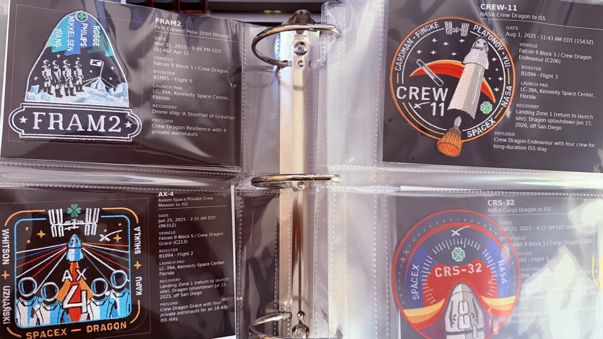
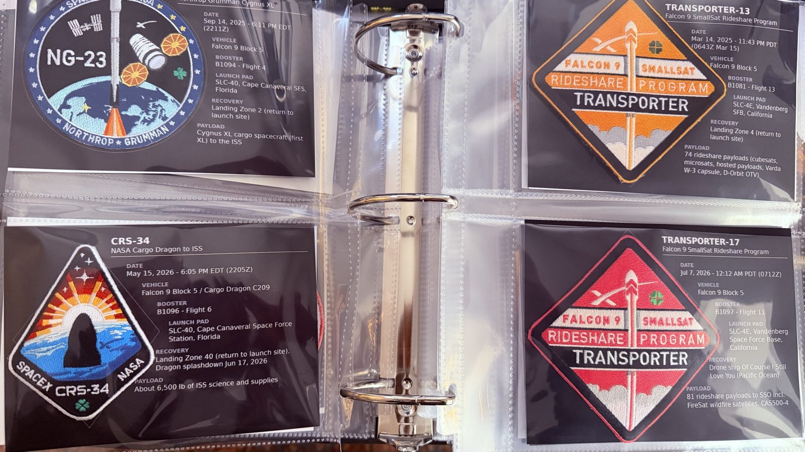
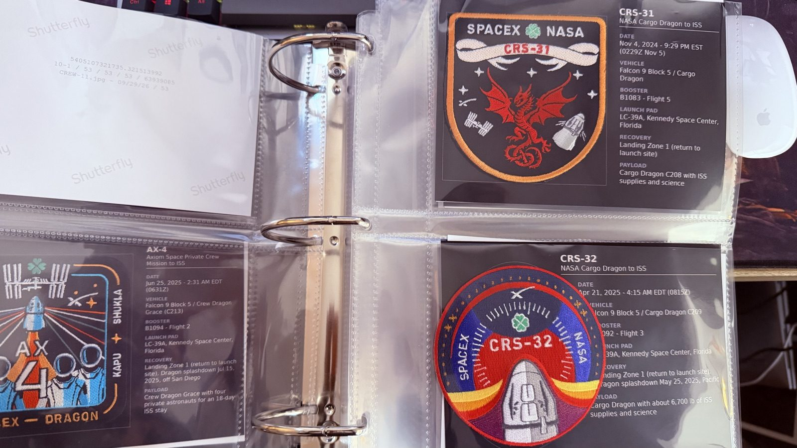
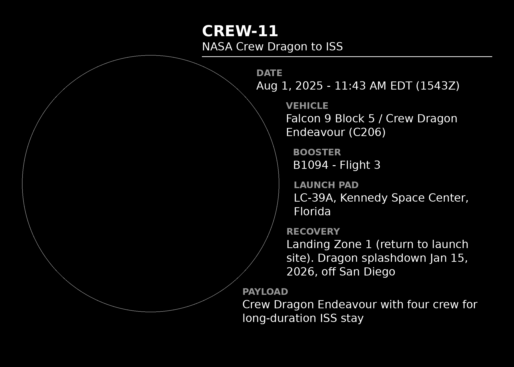
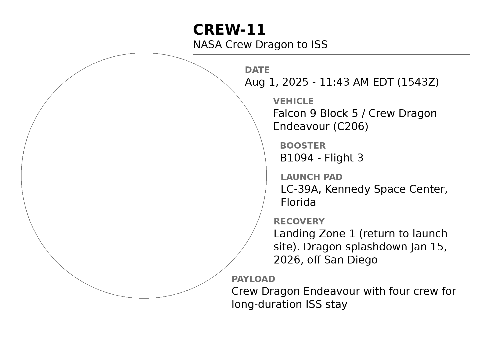

# Mission Patch Cards

Printable 7 × 5 in info cards for a collection of SpaceX-era mission patches.
Each card has a space sized to the real patch, with the mission's key facts
beside it: date, vehicle, booster, launch pad, recovery and payload. The cards
are printed as photos and go into a binder with the patch on top.







## What a card looks like

The script makes a white-on-black card and a black-on-white card for every
mission. The grey outline shows where the patch goes, and the text wraps
around round and diamond patches.

| Black ([cards/CREW-11.png](cards/CREW-11.png)) | White ([white-cards/CREW-11.png](white-cards/CREW-11.png)) |
|---|---|
|  |  |

## Making the cards

You need Python 3 and Pillow:

```bash
pip install pillow
```

Make the black cards (into `cards/`):

```bash
python3 make_cards.py missions.json
```

Make the white cards (into `white-cards/`):

```bash
python3 make_cards.py missions.json --white
```

Options:

- `--only CREW-11 AX-4` makes only those missions.
- `--no-guide` leaves out the grey patch outline. Use it for final prints.
- `--out FOLDER` writes the images somewhere else.

Every card is 2100 × 1500 px at 300 dpi. If the text doesn't fit, the script
shrinks it a little at a time. When that isn't enough, it tries a portrait
card and then puts the patch above the text. A card that still overflows
gets a `WARNING` line.

## Adding a mission

Add an entry to `missions.json`:

```json
{
  "id": "CREW-11",
  "title": "CREW-11",
  "subtitle": "NASA Crew Dragon to ISS",
  "patch": { "width_in": 3.5, "height_in": 3.5, "shape": "round" },
  "booster": { "id": "B1094", "flight": 3 },
  "fields": [
    { "label": "DATE", "value": "Aug 1, 2025 - 11:43 AM EDT (1543Z)" },
    { "label": "VEHICLE", "value": "Falcon 9 Block 5 / Crew Dragon Endeavour (C206)" },
    { "label": "LAUNCH PAD", "value": "LC-39A, Kennedy Space Center, Florida" }
  ]
}
```

- `id`, `title` and `fields` are required. The image file is named after `id`.
- `patch` is the patch's real size in inches. `shape` can be `rect` (the
  default), `round` or `diamond`.
- When `booster` is set, a BOOSTER line ("B1094 - Flight 3") goes right after
  VEHICLE.
- `fields` can hold any labels, in any order.

## Files

| Path | What it is |
|---|---|
| `make_cards.py` | The card generator |
| `missions.json` | Data for every mission |
| `display_order.csv` | The order and grouping of the missions in the binder |
| `patch_size_manual.csv` | Patch sizes measured by hand (already copied into `missions.json`) |
| `Photos/` | Photos of the patches |
| `cards/`, `white-cards/` | The generated cards |
| `archive/` | Earlier versions of the scripts, data and card sets |
| `docs/images/` | The photos used in this README |
